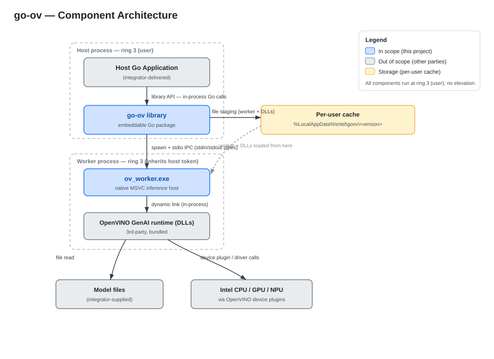

# go-ov
A lightweight OpenVino client library for Go applications.

 ***NOTE:*** **This is still a work in progress and not recommended for production use yet. Suggestions and feedback are welcome.**

The purpose of this library is to simplify the using of local LLMs for light text-only inference jobs within Go applications in Windows without requiring the use of an entire OpenVINO Model Server (OVMS) installation. `go-ov` allows you to load any model compatible with OpenVINO in IR format and provides some control over how the model is loaded and utilized (CPU vs GPU vs NPU vs AUTO). Responses can be generated as full-text or token stream.

Because of compatibility issues between CGO and OpenVINO runtime DLLs, this library uses a lightweight c++ executable (438kb) to bridge calls between go and OpenVINO. The executable is bundled as an embedded resource within the library. On first use, it is extracted and written to a disk location, from where it is used for any subsequent invocations. By default the worker is saved to `~\AppData\Local\Intel\goov\<VERSION>`

The library only includes the Go code as well as the OV bridge executable, host applications must provide the OpenVINO runtime DLLs as well as the AI model. 

## Architecture Diagram




## Installation
```bash
go get https://github.com/intel/go-ov
```

AI Model and OpenVINO runtime DLLs must be provided separately.

## How To Use

Before using go-ov you need the following pre-requisites:

* A model optimized for OpenVino. You can [find several options](https://huggingface.co/models?library=openvino) in the HuggingFace site. The [download-model.sh](util/download-model.sh) helper script is provided as a convenience to download models from HuggingFace.
* A directory with the required OpenVINO GenAI runtime DLLs. Use the [make-ov-runtime.sh](util/make-ov-runtime.sh) to create a zip with the necessary files.

Start by importing the goov library into your code
```go
import (
    goov "github.com/intel/go-ov"
)
```

Create an object to hold your engine configuration and point it to the locations of your model and runtime OV DLLs. Use it to create a new instance of the LLM Engine. At this point there are no OpenVino processes running in the background, this only creates the environment for using the library.
```go
opts := goov.DefaultEngineOpts()    // or SafeEngineOpts() for doing a low impact CPU-only inference
opts.ModelPath = filepath.Join(cwd, "models/qwen2.5-1.5b-int4")
opts.LibraryPath = filepath.Join(cwd, "bin")

engine, _ := goov.New(opts)
```

Use the `Generate()` function to generate a reponse from a prompt without initiating a full persistent session. This function will invoke the OpenVino worker, execute the inference and then terminate the worker immediately.
```go
cfg := goov.ChatOpts{
    MaxTokens:    100,
    Temperature:  0.5,
    SystemPrompt: "You explain system metrics in plain English. Use only provided context.",
}
resp, _ := engine.Generate("CPU: 85%, Memory: 22.6/31.GB (73%)", cfg)
fmt.Println(resp);

// sample output:
// The CPU usage is 85%, which means the CPU is working hard to handle tasks. The memory usage is 22.6/31 GB, or 73%, 
// which indicates that 73% of the available memory is being used. This suggests that the system is running efficiently, 
// with some memory pressure.
```

Alternatively, you can start a persistent interactive session with memory. This allows you to create multiple prompts/responses turns. The OpenVino worker will remain in memory until you `close()` the session or the program ends.
```go
s, err := engine.NewSession(goov.ChatOpts{
    MaxTokens:    25,
    Temperature:  0,
    SystemPrompt: "You remember cities I have visited.",
    MaxHistory:   10,
})
defer s.Close()
resp, _ := s.Generate("I have been to Paris.")
resp, _ = s.Generate("I went to New York last year.")
resp, _ = s.Generate("I remember the time I lived in Lima.")
resp, _ = s.Generate("What places I have been to?")

// Sample output:
// Paris is a beautiful city with many famous landmarks such as the Eiffel Tower, the Louvre, and the Notre-D
// New York City is a bustling metropolis with iconic landmarks like the Statue of Liberty, the Empire State Building, and Times Square
// Lima is the capital city of Peru and is known for its rich history and culture. Some of the famous landmarks in Lima
// You have visited Paris, New York, and Lima.
```


Another option is to use batch generation. In this mode you first load a number of prompts into the engine and then start the inference for all of them at the same time. Use `Generate()` to trigger the processing of all prompts. The function returns a slice of strings containing the response to each prompt on the same order they were added.
```go
b, err := engine.NewBatch(goov.ChatOpts{
    MaxTokens:    25,
    Temperature:  0,
    SystemPrompt: "You summarize the provided information.",
})
defer b.Close()
b.AddPrompt("The sky is blue")
b.AddPrompt("The sky is very big")
b.AddPrompt("The sky sometimes has clouds")
responses, err := b.Generate()

// Sample output:
// The sky appears blue due to a phenomenon called Rayleigh scattering, where shorter blue wavelengths scatter more easily from larger particles in the atmosphere.
// The sky is vast and expansive, covering the entire sky.
// The sky has clouds at times.
```

## Streaming Ouput

The go-ov library also supports generating output by streaming tokens as they are generated by the LLM. Streaming can be used at either the Engine level or the Session level. Use either `engine.Stream(prompt string, opts goov.ChatOpts)` or `session.Stream(prompt)` accordingly.

Both methods return an outbound channel of type `goov.Chunk` which contains the generated text fragment and any error that may happen during the generation. The caller is responsible for consuming the channel and draining it at the end.

```go
stream, err := s.Stream(prompt)
if err != nil {
    panic(err)
}
for chunk := range stream {
    if chunk.Err != nil {
        panic(chunk.Err)
    }
    fmt.Print(chunk.Text)
}
fmt.Println()
```

## AI Engine Configuration

When initializing the engine, the [EngineOpts](types.go) provide some levers to customize the inteference jobs. Use `SafeEngineOpts` to provide a conservative configuration to minimize impact on CPU inferences.

`EngineOpts.InferenceDevice`: Tells OpenVINO which type of device to use for running the jobs.

    - OV_INFERENCE_DEVICE_AUTO: let OpenVINO pick the best available device (with CPU fallback)
    - OV_INFERENCE_DEVICE_CPU:  run on the CPU
    - OV_INFERENCE_DEVICE_GPU:  run on the Intel integrated or discrete GPU
    - OV_INFERENCE_DEVICE_NPU:  run on the Intel NPU (AI Boost)

`EngineOpts.PerformanceMode`: Use this setting to select the OpenVINO performance hint

    - OV_PERFORMANCE_MODE_UNDEFINED:  no hint; use the OpenVINO defaults
    - OV_PERFORMANCE_MODE_LATENCY:    optimize for low latency / fast first tokens
    - OV_PERFORMANCE_MODE_THROUGHPUT: optimize for total throughput across requests

`EngineOpts.CPUPinning`: When `true` provides a hint to the engine to pin inference threads to cores. Only applicable when inference device is CPU.

`EgineOpts.NumThreads`: Number of CPU threads to use. When 0, OpenVINO uses its default behavior. Only applicable when inference device is CPU.

`EngineOpts.ModelPath`: Should point to the directory containing the LLM files.

`EngineOpts.LibraryPath`: Should point to the directory containing the OpenVINO DLL files

`EngineOpts.DebugMode`: Set to `true` to display additional debugging output and telemetry.

## Text Generation Configuration

The [ChatOpts](types.go) object is sued to provide OpenVINO with parameters specific for generating text.

`ChatOpts.MaxTokens`: Maximum number of tokens to generate on responses. When 0, OpenVINO uses its default behavior.

`ChatOpts.Temperature`: Value (`float32`) to use for controlling the "temperature" of the responses. Use 0 for deterministic/greedy output.

`ChatOpts.SystemPrompt`: This property sets the System Prompt to use for all text generation jobs.

`ChatOpts.MaxHistory`: Maximum number of retained user/assistant messages (excludes system). When the history reaches this value, older entries are removed.

## Contributing

See [Contributing](CONTRIBUTING.md) for guidelines.

## License

This project is licensed under the MIT License - see the [LICENSE](LICENSE) file for details.

## Support

- [Issues](https://github.com/intel/go-ov/issues) - Bug reports and feature requests

Project maintainers will work on a best-effort basis to address any bug reports, feature requests and submitted contributions.

